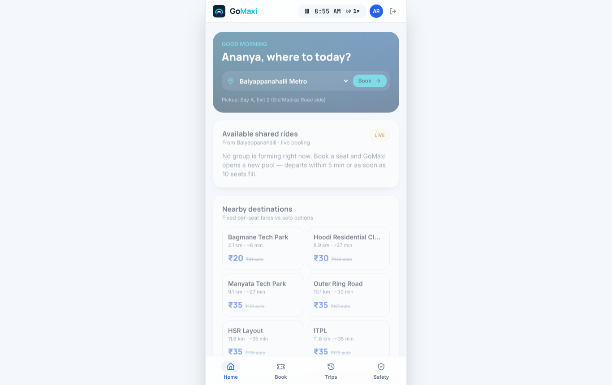
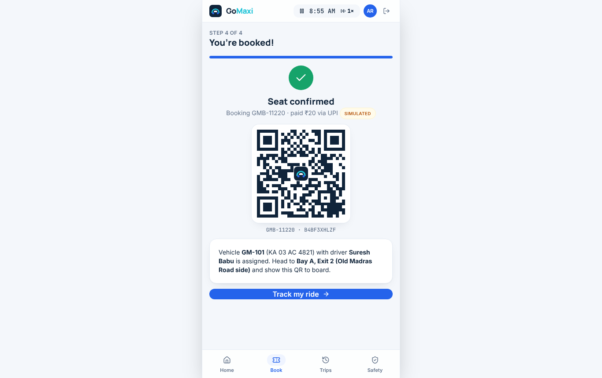
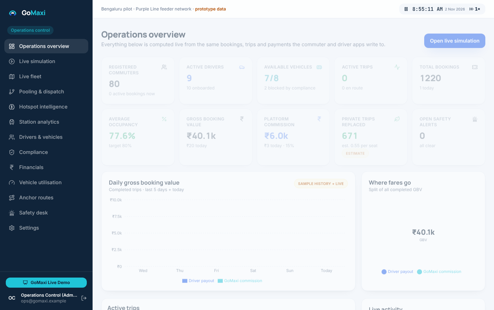
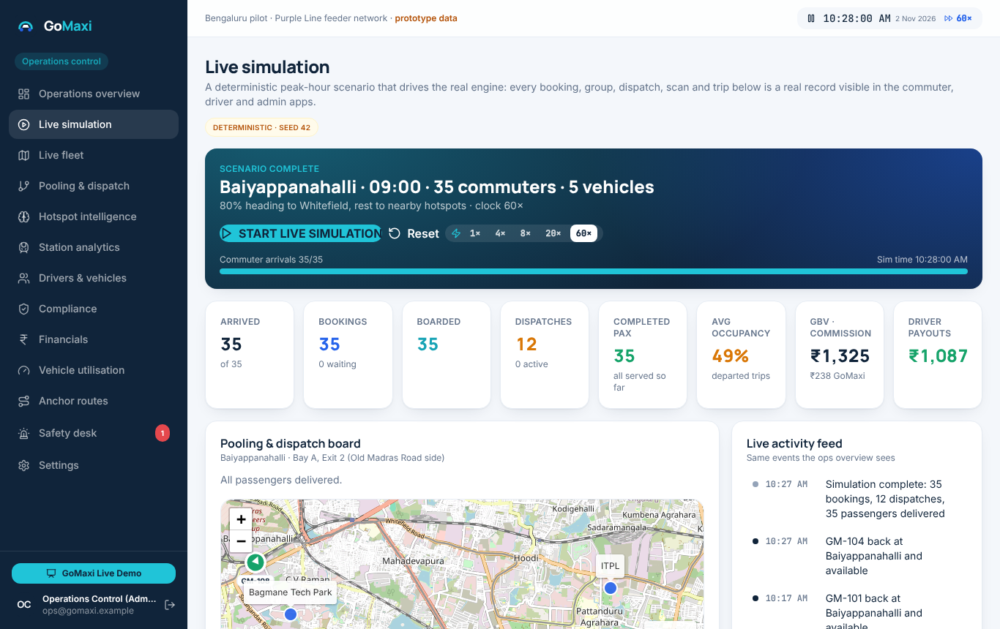

# GoMaxi — Your Metro. Your Last Mile. Your Way.

An interactive, end-to-end prototype of **GoMaxi**, a metro-integrated shared mobility platform for Bengaluru.
It pools metro commuters heading to the same hotspot into shared Maxi Cabs / Tempo Travellers at fixed per-seat
fares, using eligible commercial vehicles during the hours they would otherwise sit idle.

This repository contains four role-based apps on **one shared live engine**, a deterministic peak-hour
simulation, a judge-facing demo mode, an interactive financial model, a rule-based demand-scoring prototype,
regulatory research and a complete test suite.

| App | Who | Form factor |
|---|---|---|
| Commuter app | riders | mobile-first |
| Driver app | drivers of partner vehicles | mobile-first |
| Operations admin | GoMaxi ops / investors | desktop-first |
| Metro authority view | BMRCL-style analysts (aggregates only) | desktop-first |
| **GoMaxi Live Demo** | competition judges | 6-step presentation |

 



## Live demo (no install)

The app is published automatically to **GitHub Pages** on every push:
**https://deekshithagudise.github.io/GoMaxi/** (workflow: `.github/workflows/pages.yml`).

Prefer Vercel? One click: [Deploy with Vercel](https://vercel.com/new/clone?repository-url=https://github.com/DeekshithaGudise/GoMaxi) — `vercel.json` is already configured.

## Quick start

Requirements: Node.js 18+ (tested on Node 22) and a modern browser (Chrome/Edge/Firefox/Safari). `npm` is
installed together with Node.js — if PowerShell says `npm is not recognized`, Node.js is not installed yet.

**Windows (easiest):** download the repository, open PowerShell in the project folder and run

```powershell
Set-ExecutionPolicy -Scope Process Bypass; .\setup-windows.ps1
```

The script installs Node.js LTS if needed (via winget), installs dependencies and opens the app. If it says to
reopen PowerShell, do that and run it once more.

**Manual (Windows / macOS / Linux):** install Node.js LTS from https://nodejs.org, open a new terminal in the
project folder, then

```bash
npm install
npm run dev        # http://localhost:5173
```

Other scripts:

```bash
npm test           # 25 engine tests (pooling, dispatch, QR, payments, finance, consistency, simulation)
npm run build      # typecheck + production build to dist/
npm run preview    # serve dist/ on http://127.0.0.1:4173
npm run e2e        # browser walkthrough of the acceptance test (needs Playwright + a running preview)
```

No environment variables are required. `.env.example` lists the variables reserved for production
integrations (Supabase, Razorpay, custom map tiles).

## The 3-minute acceptance walkthrough

Open the app, then (ideally in three browser tabs — they share one live system):

1. **Commuter tab** → *Commuter app* → pick **Ananya Rao** → **Book** → station → destination → *Continue to
   payment* → *Pay*. You get a **unique QR boarding pass**; the vehicle and driver are assigned immediately.
2. **Driver tab** → *Driver app* → pick the driver shown on the pass (e.g. **Suresh Babu / GM-101**) →
   **Trip** → *Accept* → **Scan** → use the camera, or type the booking ID (manual fallback) → *Verify* →
   "Boarding accepted". Scan again to see the **duplicate blocked**. Back in **Trip** → *Start trip* →
   *End trip*.
3. **Admin tab** → *Operations admin* → the booking, trip, commission and driver payout are already in
   **Operations overview**, **Pooling & dispatch** (decision log), **Financials → Prototype actuals**,
   **Vehicle utilisation** and **Hotspot intelligence**. Change assumptions in **Financials** and watch every
   figure recompute.
4. **Live simulation** → **START LIVE SIMULATION** (Baiyappanahalli, 09:00, 35 commuters, 5 vehicles). Speed
   the clock to 20× or 60×. Watch arrivals → pooling → vehicle assignment → threshold/timeout dispatch → QR
   boarding → trips → earnings, all as real records.
5. **GoMaxi Live Demo** (button on the login page / sidebar) walks a judge through problem → solution →
   supply model → live operations → economics → impact.

The scripted version of this walkthrough is `scripts/acceptance.mjs` (19 checks, screenshots in
`e2e-output/`).

## Clock and speed

Everything runs on one **simulated clock** (demo day Monday 2 Nov 2026, starting 08:55 IST) shown in every
header. Pause it or change speed (1×–60×) anywhere; all tabs follow. The pooling timer (5 min) and trip
durations are in simulated time, so you never have to wait real minutes during a demo.

## What is real and what is simulated

| Capability | Status in this prototype |
|---|---|
| Booking, pooling, vehicle assignment, dispatch rules, rollover, cancellation, expiry | **Real logic**, tested, shared by all apps |
| QR generation and validation, duplicate prevention, offline queue sync | **Real logic**; camera scanning via `html5-qrcode` where a camera exists, manual fallback otherwise |
| Payments (UPI / card / wallet), refunds | **Simulated gateway** — clearly labelled; interface mirrors a Razorpay order/capture/refund flow |
| Vehicle positions and tracking | **Simulated GPS** along planned corridors (interpolated), labelled |
| Metro exit volumes, office headcounts | **Illustrative assumptions**, labelled; to be replaced by BMRCL / partner data |
| Hotspot demand "intelligence" | **Rule-based scoring prototype** with visible weights and contributions — *not* a trained ML model |
| Safety escalation (SOS, deviation) | **Simulated** — records and timelines are real, no SMS/call/112 integration |
| Financial model | **Illustrative assumptions**, internally consistent, editable; not validated financials |
| Regulatory status | Researched and classified in `docs/REGULATORY_RESEARCH.md`; **GoMaxi is not authorised to operate** |
| Sample history | Deterministically generated 5-day history (≈1,200 bookings, 150 trips) so dashboards are populated |
| Persistence / multi-tab | localStorage + cross-tab leader election (Web Locks + BroadcastChannel) |

## Project structure

```
src/domain/     entity model, seed data, engine (pooling, dispatch, boarding, payments, safety, anchor routes,
                simulation, demand scoring, finance, analytics), store with leader/follower sync, tests
src/app/        auth, commuter, driver, admin (+ metro mode), demo, shared UI/map/charts/QR
supabase/       schema.sql — production PostgreSQL target for the same entities
docs/           ARCHITECTURE, DATABASE_SCHEMA, DEMO_GUIDE, REGULATORY_RESEARCH, LIMITATIONS_AND_ROADMAP, screenshots
research/       compliance-checklist.json (source of the admin Compliance page)
scripts/        acceptance.mjs — Playwright walkthrough of the acceptance criteria
```

See `docs/ARCHITECTURE.md` for the engine design and `docs/DEMO_GUIDE.md` for a presenter script.

## Sample accounts

All logins are demo persona selections (no OTP). Registration of new commuters works and persists locally.

* Commuters: Ananya Rao, Rahul Menon, Priya Sharma, … (20 named + 60 anonymised historical riders)
* Drivers: Suresh Babu (GM-101), Manjunath K (GM-102), Ravi Kumar (GM-103), … (10). **Shivakumar M (GM-109)**
  is deliberately *not* dispatch-eligible (permit pending, police verification pending, PSV badge expired) and
  **GM-110** has expired insurance — use them to demonstrate compliance gates in *Drivers & vehicles*.
* Admin: Operations Control. Metro authority: Metro Authority Analyst.

## Key numbers (defaults, all configurable)

Capacity 12 · target occupancy 80 % (threshold 10) · max wait 5 min · boarding grace 2 min · commission 15 % ·
average fare ₹25 (fixed fares ₹20–50 by distance). 12 × ₹25 = ₹300 GBV → ₹45 GoMaxi / ₹255 driver; two full
trips per hour → ₹600 / ₹90 / ₹510 (verified by tests).

## Licence and attribution

Map tiles © OpenStreetMap contributors (loaded live; the app works without them, markers still render).
Prototype code © GoMaxi team. See `docs/REGULATORY_RESEARCH.md` for cited sources.
